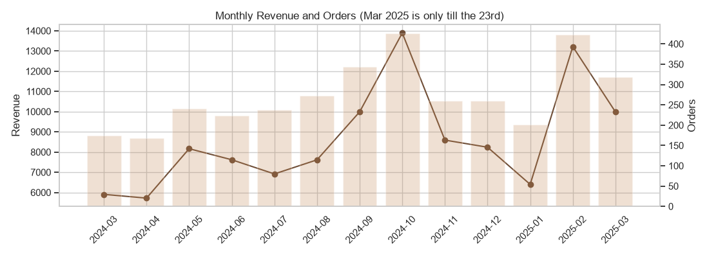
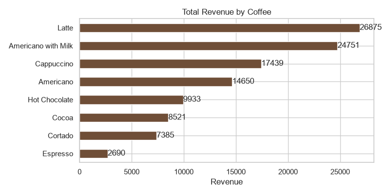
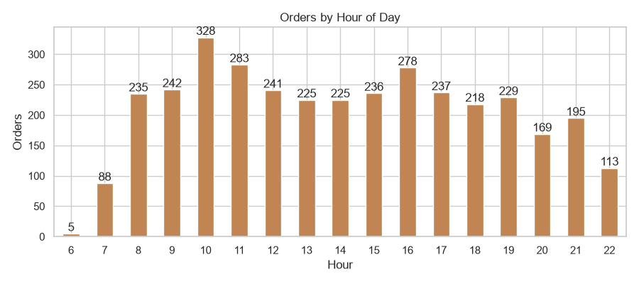
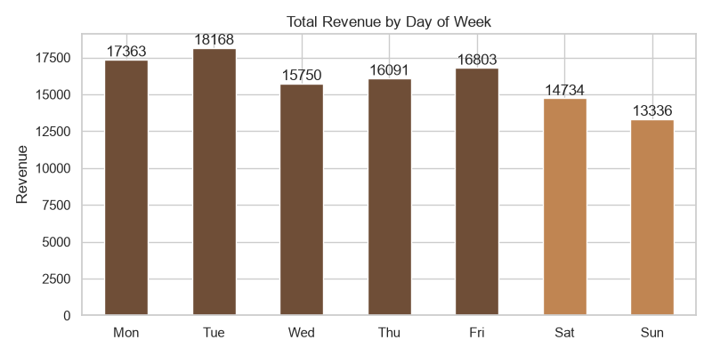
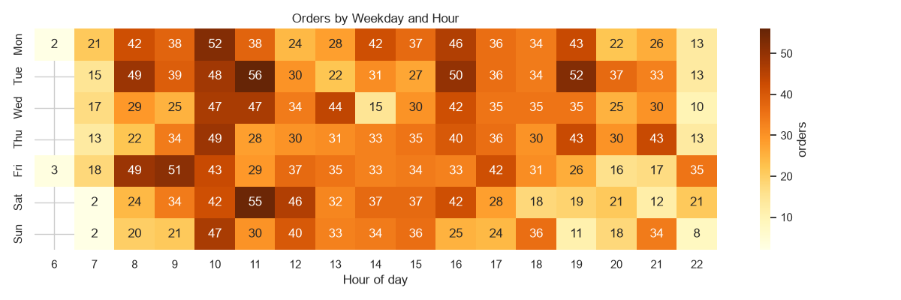
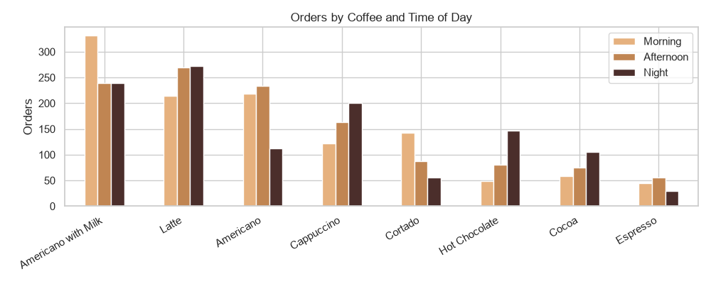
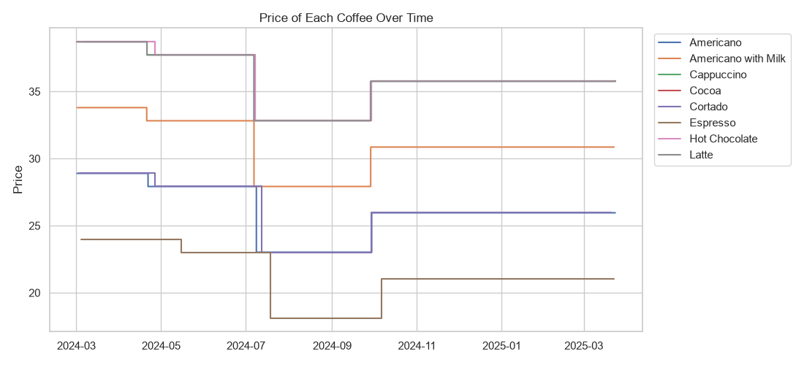

# ☕ Coffee Sales Trend Analysis | SQL, Python & Power BI

[](https://www.mysql.com/)
[](https://www.python.org/)
[](https://powerbi.microsoft.com/)
[](https://github.com/Yasheekaa)
[](./LICENSE)

> Analysis of one year of coffee shop transactions (3,547 orders, March 2024 to March 2025). I load the data into **MySQL** and answer business questions with SQL, check and clean it with **Python**, and present the main numbers in a **Power BI** dashboard.

---

## 📌 Business Questions

1. How much revenue does the shop make, and which coffees bring in the most money?
2. What are the busiest hours and days, and is the weekend really slower?
3. How did sales change month by month?
4. Do customers order different coffees in the morning vs at night?
5. Did price changes during the year affect sales?

---

## 📊 Dashboard

<p align="center">
  
</p>

The dashboard ([`dashboard/coffee_sales_dashboard.pbix`](dashboard/coffee_sales_dashboard.pbix)) has product cards for each coffee, KPI cards (total spend, peak hour, peak hour cups and spend, weekend spend), a spending trend over time, spend by day of week and spend by time period, with a slicer to filter by coffee.

**DAX measures used in the report**

```dax
Total_Spend    = SUM('coffee_data'[money(Rs)])
Total Cup Sold = COUNT(coffee_data[coffee_name])

Peak_Hour =
VAR HourTable = SUMMARIZE('coffee_data', 'coffee_data'[hour_of_day], "Cups", COUNT('coffee_data'[coffee_name]))
VAR MAXCups   = MAXX(HourTable, [Cups])
RETURN MAXX(FILTER(HourTable, [Cups] = MAXCups), [hour_of_day])

Peak_Hour_Lable = FORMAT(TIME([Peak_Hour], 0, 0), "h AM/PM")

Peak Hour Cups =
VAR HourCups = SUMMARIZE('coffee_data', 'coffee_data'[hour_of_day], "TotalCups", COUNTROWS('coffee_data'))
RETURN MAXX(TOPN(1, HourCups, [TotalCups], DESC), [TotalCups])

Peak Hour Spend =
VAR HourTable = SUMMARIZE('coffee_data', 'coffee_data'[hour_of_day], "Spend", SUM('coffee_data'[money(Rs)]))
RETURN MAXX(HourTable, [Spend])

Weekend_Spend = CALCULATE([Total_Spend], 'coffee_data'[Weekday] IN { "Sat", "Sun" })

Weekend_Average_Spend =
AVERAGEX(
    FILTER(VALUES('coffee_data'[Weekday]), 'coffee_data'[Weekday] IN { "Sat", "Sun" }),
    CALCULATE([Total_Spend])
)
```

There are also `Weekday_Spend` and `Weekday_Average_Spend` (same logic for Mon to Fri) and a `Coffee_Images` measure that returns an image URL for each coffee card. The card icons are my own simple drawings, stored in [`images/coffee/`](images/coffee).

The report loads `data/coffee_data.csv` straight from this GitHub repo (`Web.Contents` in Power Query), so it refreshes on any laptop without changing a file path.

---

## 🗃️ Dataset

`data/coffee_data.csv`: 3,547 rows, 11 columns, from a public coffee sales dataset on Kaggle.

| Column | Example | Notes |
| :--- | :--- | :--- |
| `hour_of_day` | `10` | 6 to 22 |
| `cash_type` | `card` | **every row is card** |
| `money(Rs)` | `38.70` | amount of the order |
| `coffee_name` | `Latte` | 8 coffees |
| `Time_of_Day` | `Morning` | Morning (6-11), Afternoon (12-16), Night (17-22) |
| `Weekday`, `Weekdaysort` | `Fri`, `5` | Mon = 1 ... Sun = 7 |
| `Month_name`, `Monthsort` | `Mar`, `3` | **no year**, see data issues below |
| `Date` | `3/1/2024` | M/D/YYYY |
| `Time` | `15:50.5` | **broken**, see data issues below |

---

## 🧹 Data Issues I Found (and fixed)

| Issue | Why it matters | What I did |
| :--- | :--- | :--- |
| The SQL script created the table but never loaded the CSV | Anyone running the script got empty results | Added a `LOAD DATA LOCAL INFILE` step |
| `Date` was stored as `VARCHAR` | Date functions and sorting did not work properly | Stored as `DATE` using `STR_TO_DATE` |
| `Month_name` / `Monthsort` have no year, but the data covers Mar 2024 to Mar 2025 | My first monthly trend and MoM queries added March 2024 and March 2025 together | Grouped by year + month (`DATE_FORMAT(Date, '%Y-%m')`) |
| `Time` lost its hour (Excel format), e.g. `15:50.5` means 15 min 50 s | Exact order time was not available | Rebuilt `order_time` from `hour_of_day` + minutes and seconds (8 rows already had a full time) |
| All payments are card | Cash vs card comparison is not possible | Kept the query but noted it, removed cash claims from this README |
| Every coffee has 4 different prices | Revenue changes are partly price changes | Added a price history query and chart |

---

## 🚀 Key Insights

- **Total revenue Rs 1,12,245** from 3,547 orders. Average order value **Rs 31.65**, about **9 orders and Rs 295 per day**.
- **Latte** earns the most (23.9% of revenue) while **Americano with Milk** is ordered the most (809 orders). The top 4 coffees make about **75%** of revenue and Espresso only 2.4%.
- **10 AM is the peak hour** (328 orders), with a second peak at **4 PM** (278).
- Revenue is almost equal across **Morning 32%, Afternoon 34% and Night 34%**.
- Mornings are mostly Americano with Milk and Cortado. At night Latte, Cappuccino, Hot Chocolate and Cocoa go up.
- **Weekdays are busier:** Rs 309 per weekday vs Rs 258 per weekend day (about 17% less). Tuesday is the best day and Sunday the weakest.
- **Best months:** October 2024 (Rs 13,891) and February 2025 (Rs 13,215). Weakest: April 2024 and January 2025.
- **Prices changed 3 times.** All coffees got cheaper in July 2024 and more expensive again from late September 2024. The best month came after the price increase, so price alone does not explain demand.

---

## 📈 Python EDA

The notebook [`notebooks/coffee_sales_eda.ipynb`](notebooks/coffee_sales_eda.ipynb) checks data quality, rebuilds the order time, saves `data/coffee_data_clean.csv` and creates these charts:

| | |
| :---: | :---: |
|  |  |
|  |  |
|  |  |



---

## 🔍 SQL Highlights

[`sql/coffee_sales_analysis.sql`](sql/coffee_sales_analysis.sql) has the table, the CSV load, 5 data checks and 23 business questions.

**Monthly revenue (fixed to use year + month)**
```sql
SELECT
    DATE_FORMAT(`Date`, '%Y-%m') AS sales_month,
    COUNT(*) AS total_orders,
    ROUND(SUM(`money(Rs)`), 2) AS revenue
FROM coffee_data
GROUP BY DATE_FORMAT(`Date`, '%Y-%m')
ORDER BY sales_month;
```

**Weekday vs weekend, average revenue per day**
```sql
WITH daily_sales AS (
    SELECT `Date`, Weekday, SUM(`money(Rs)`) AS day_revenue, COUNT(*) AS day_orders
    FROM coffee_data
    GROUP BY `Date`, Weekday
)
SELECT
    CASE WHEN Weekday IN ('Sat', 'Sun') THEN 'Weekend' ELSE 'Weekday' END AS day_type,
    COUNT(*) AS days,
    ROUND(AVG(day_revenue), 2) AS avg_revenue_per_day,
    ROUND(AVG(day_orders), 1) AS avg_orders_per_day
FROM daily_sales
GROUP BY CASE WHEN Weekday IN ('Sat', 'Sun') THEN 'Weekend' ELSE 'Weekday' END;
```

**Top 3 coffees in each time of day (window function)**
```sql
WITH product_by_daypart AS (
    SELECT
        Time_of_Day,
        coffee_name,
        COUNT(*) AS total_orders,
        ROW_NUMBER() OVER (PARTITION BY Time_of_Day ORDER BY COUNT(*) DESC) AS rank_in_daypart
    FROM coffee_data
    GROUP BY Time_of_Day, coffee_name
)
SELECT Time_of_Day, rank_in_daypart, coffee_name, total_orders
FROM product_by_daypart
WHERE rank_in_daypart <= 3
ORDER BY FIELD(Time_of_Day, 'Morning', 'Afternoon', 'Night'), rank_in_daypart;
```

Other queries include month-over-month growth with `LAG`, a Pareto ranking with `DENSE_RANK` and running totals, price history per coffee, the busiest hour of every weekday and each coffee's share of monthly revenue.

---

## 💡 Recommendations

1. **Staffing:** keep an extra barista from 9 to 11 AM and around 4 PM, mainly on Mondays and Tuesdays.
2. **Weekend offers:** a weekend day makes about 17% less than a weekday, so weekend combos or loyalty points could help.
3. **Stock planning:** Latte and Americano with Milk are almost half of the revenue, so milk and espresso beans should never run out.
4. **Evening menu:** promote Hot Chocolate, Cocoa and Cappuccino after 5 PM when they sell the most.

---

## 📁 Repository Structure

```text
Coffee-Sales-Trend-Analysis/
├── data/
│   ├── coffee_data.csv              # original dataset (3,547 rows)
│   └── coffee_data_clean.csv        # cleaned by the notebook (order_datetime, year_month, ...)
├── sql/
│   └── coffee_sales_analysis.sql    # schema, CSV load, data checks, 23 queries
├── notebooks/
│   └── coffee_sales_eda.ipynb       # Python data checks + EDA
├── dashboard/
│   └── coffee_sales_dashboard.pbix  # Power BI report
├── images/
│   ├── dashboard.png
│   ├── coffee/                      # icons used on the dashboard product cards
│   └── charts/                      # charts saved by the notebook
├── requirements.txt
├── LICENSE
└── README.md
```

---

## ⚙️ How to Run

```bash
git clone https://github.com/Yasheekaa/Coffee-Sales-Trend-Analysis.git
cd Coffee-Sales-Trend-Analysis
```

**SQL (MySQL 8.0)**
1. Enable local file loading once: `SET GLOBAL local_infile = 1;` (in MySQL Workbench also add `OPT_LOCAL_INFILE=1` under *Edit Connection > Advanced > Others*).
2. Run the script from the repo folder:
   ```bash
   mysql --local-infile=1 -u root -p < sql/coffee_sales_analysis.sql
   ```
   or open it in MySQL Workbench and change the path in the `LOAD DATA` line to your full path.

**Python**
```bash
pip install -r requirements.txt
cd notebooks
jupyter notebook coffee_sales_eda.ipynb
```

**Power BI**
Open `dashboard/coffee_sales_dashboard.pbix` and click **Refresh**. The data comes from the raw CSV link of this repo, so choose **Anonymous** if Power BI asks how to connect. To work offline, change the source in *Transform data* to `File.Contents` with the path of `data/coffee_data.csv` on your computer.

---

## 📚 What I Learned

- A month column without a year can silently mix two different months. Always check the full date range first.
- Check every column before trusting it. The `Time` column and the payment type both looked normal until I counted the values.
- Comparing totals between groups of different size (5 weekdays vs 2 weekend days) can be misleading, averages per day are fairer.

---

## 👩‍💻 Author

**Yashika Singh**
- GitHub: [@Yasheekaa](https://github.com/Yasheekaa)
- LinkedIn: [Yashika Singh](https://www.linkedin.com/in/yashika-singh-33983a329/)
- Email: [yashikasingh120104@gmail.com](mailto:yashikasingh120104@gmail.com)

📄 Licensed under the [MIT License](./LICENSE).
