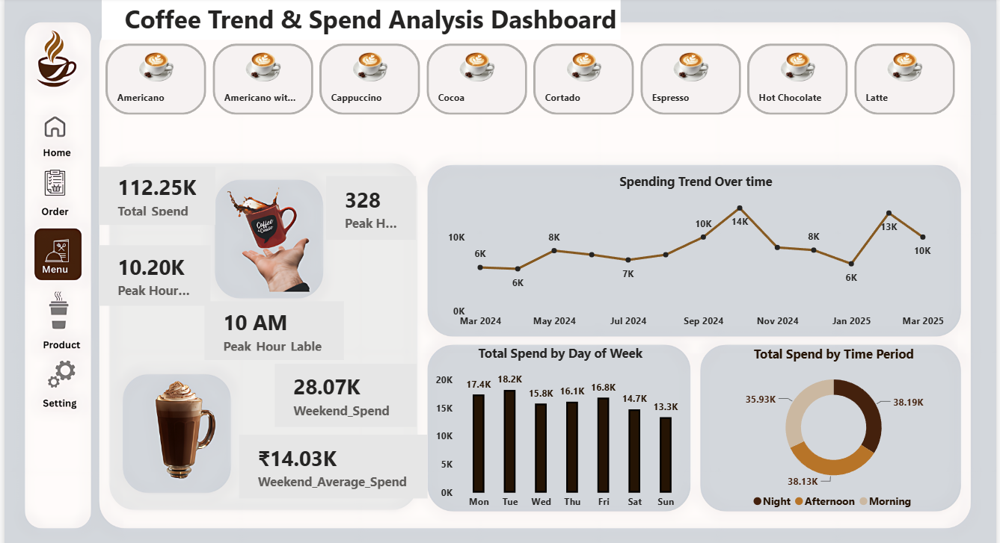
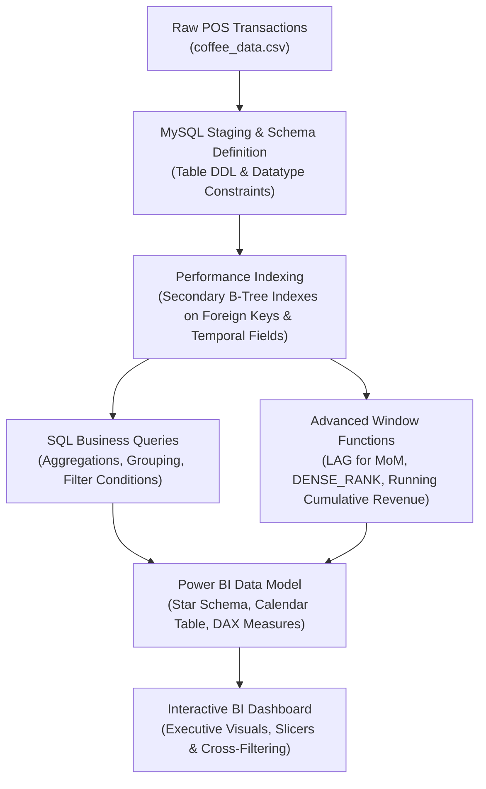

# ☕ Coffee Sales Trend Analysis | SQL & Power BI

[](https://www.mysql.com/)
[](https://powerbi.microsoft.com/)
[](https://learn.microsoft.com/en-us/dax/)
[](https://github.com/Yasheekaa)
[](https://opensource.org/licenses/MIT)

> An end-to-end retail business intelligence project exploring multi-month coffee shop transaction patterns. Incorporates relational database schema modeling, performance-indexed SQL analysis, advanced window functions, and an interactive Power BI executive dashboard for data-driven retail decisions.

---

## 📌 Executive Summary

Modern retail coffee operations handle thousands of micro-transactions weekly across shifting dayparts, varied payment mechanisms, and dynamic customer preferences. This project delivers an end-to-end analytical framework that transforms granular Point-of-Sale (POS) data into actionable business intelligence.

Through structured MySQL database modeling and Power BI reporting, this study addresses critical operational challenges:
- **Product Portfolio Performance:** Pinpointing high-margin versus high-volume beverage offerings.
- **Temporal Patterns & Peak Dynamics:** Isolating hourly rushes and weekday revenue concentrations to drive intelligent staffing and barista shift allocation.
- **Payment Behavior Dynamics:** Analyzing digital card versus cash preferences across dayparts to streamline checkout efficiency.
- **Trend Forecasting & Seasonality:** Tracking month-over-month performance and cumulative revenue velocity.

---

## 📊 Interactive Dashboard Showcase

The Power BI dashboard translates SQL analytical findings into an intuitive, multi-dimensional executive control room:

<p align="center">
  
</p>

### Key Interface Highlights
- **Real-Time KPI Cards:** Instant visibility into Total Revenue, Transaction Volume, and Average Ticket Size.
- **Sales Trends & Seasonality:** Monthly revenue trajectories and weekday distribution curves.
- **Product Contribution Matrix:** Revenue and volume breakdown across coffee varieties (Latte, Americano, Cappuccino, etc.).
- **Daypart & Hourly Segmentation:** Granular morning, afternoon, and night shift performance gauges.
- **Payment Split Analytics:** Digital card transactions vs. cash settlement ratios.

---

## 🏗️ Technical Architecture & Data Pipeline

The project follows a standard production data lifecycle, moving from raw transaction logs through relational storage, analytical query execution, and business intelligence reporting:



---

## 📂 Data Dictionary & Schema Specification

The dataset captures POS micro-transactions across calendar months, recording temporal attributes, product categories, and transaction monetary values.

| Column Name | Data Type | Constraint | Description | Sample Value |
| :--- | :--- | :--- | :--- | :--- |
| `transaction_id` | `INT` | Primary Key, Auto-Increment | Unique identifier generated for each transaction | `1001` |
| `hour_of_day` | `INT` | `0 <= hour <= 23` | Operating hour during which transaction occurred | `10` |
| `cash_type` | `VARCHAR(20)` | `NOT NULL` | Payment settlement method (`card` or `cash`) | `card` |
| `money(Rs)` | `DECIMAL(10,2)` | `NOT NULL` | Transaction total amount in INR | `38.70` |
| `coffee_name` | `VARCHAR(100)` | `NOT NULL` | Specific coffee beverage purchased | `Latte` |
| `Time_of_Day` | `VARCHAR(20)` | `NOT NULL` | Operating shift categorization (`Morning`, `Afternoon`, `Night`) | `Morning` |
| `Weekday` | `VARCHAR(20)` | `NOT NULL` | Abbreviated day of transaction (`Mon`, `Tue`, etc.) | `Fri` |
| `Month_name` | `VARCHAR(20)` | `NOT NULL` | Abbreviated calendar month (`Mar`, `Apr`, etc.) | `Mar` |
| `Weekdaysort` | `INT` | `1 to 7` | Chronological sorting index for weekdays | `5` |
| `Monthsort` | `INT` | `1 to 12` | Chronological sorting index for calendar months | `3` |
| `Date` | `VARCHAR(20)` | `NOT NULL` | Calendar transaction date (`M/D/YYYY`) | `3/1/2024` |
| `Time` | `VARCHAR(20)` | `NOT NULL` | Exact transaction timestamp | `15:50.5` |

---

## 🔍 Core SQL Analytics & Business Rationale

The analysis is structured around concrete business objectives. Below is a representative selection of business problems addressed in [`coffee sql.sql`](coffee%20sql.sql):

### 1. Overall Revenue and Order Baseline
```sql
-- Question 1: Total Revenue
SELECT ROUND(SUM(`money(Rs)`), 2) AS total_revenue
FROM coffee_data;

-- Question 2: Total Order Volume
SELECT COUNT(*) AS total_orders
FROM coffee_data;
```
> **Business Rationale:** Establishes the macro-level benchmark for commercial scale and average transaction size across the operating period.

### 2. Product Contribution & Menu Engineering
```sql
-- Question 3: Revenue by Coffee Product
SELECT
    coffee_name,
    ROUND(SUM(`money(Rs)`), 2) AS revenue
FROM coffee_data
GROUP BY coffee_name
ORDER BY revenue DESC;

-- Question 4: Order Volume by Product
SELECT
    coffee_name,
    COUNT(*) AS total_orders
FROM coffee_data
GROUP BY coffee_name
ORDER BY total_orders DESC;
```
> **Business Rationale:** Identifies the primary cash-cow products (e.g., Latte, Americano) versus niche offerings, guiding raw ingredient procurement (coffee beans, specialty dairy, syrups).

### 3. Payment Processing Channel Preferences
```sql
-- Question 5: Revenue by Payment Method
SELECT
    cash_type,
    ROUND(SUM(`money(Rs)`), 2) AS revenue
FROM coffee_data
GROUP BY cash_type;
```
> **Business Rationale:** Evaluates card transaction penetration to optimize merchant POS terminal contracts and cashless incentives.

### 4. Day-of-Week Revenue Distribution
```sql
-- Question 7: Revenue Distribution Across Weekdays
SELECT
    Weekday,
    ROUND(SUM(`money(Rs)`), 2) AS revenue
FROM coffee_data
GROUP BY Weekday
ORDER BY revenue DESC;
```
> **Business Rationale:** Distinguishes high-volume weekday commercial customer patterns from weekend leisure demand, supporting targeted promotional calendars.

### 5. Shift & Daypart Demand Dynamics
```sql
-- Question 10, 11, 12: Product Preference by Operating Shift
SELECT coffee_name, COUNT(*) AS total_orders
FROM coffee_data
WHERE Time_of_Day = 'Morning'
GROUP BY coffee_name
ORDER BY total_orders DESC;
```
> **Business Rationale:** Highlights morning espresso demand versus sweeter, afternoon dessert-coffee consumption (e.g., Hot Chocolate, Mocha), assisting prep shifts.

---

## ⚡ Performance Optimization & Advanced SQL Analytics

To elevate this repository from simple querying to production-grade data engineering, the SQL suite implements query tuning and analytical window functions:

### 1. Secondary B-Tree Indexing
```sql
CREATE INDEX idx_coffee_name ON coffee_data(coffee_name);
CREATE INDEX idx_time_of_day ON coffee_data(Time_of_Day);
CREATE INDEX idx_hour_of_day ON coffee_data(hour_of_day);
CREATE INDEX idx_weekday ON coffee_data(Weekday);
CREATE INDEX idx_monthsort ON coffee_data(Monthsort);
```
*Optimizes filtering on high-cardinality and frequent group-by columns, reducing full-table scans during aggregation pipelines.*

### 2. Month-over-Month (MoM) Growth Rate Analysis
```sql
WITH monthly_revenue AS (
    SELECT
        Month_name,
        Monthsort,
        ROUND(SUM(`money(Rs)`), 2) AS current_month_revenue
    FROM coffee_data
    GROUP BY Month_name, Monthsort
)
SELECT
    Month_name,
    current_month_revenue,
    LAG(current_month_revenue, 1) OVER (ORDER BY Monthsort) AS previous_month_revenue,
    ROUND(
        (current_month_revenue - LAG(current_month_revenue, 1) OVER (ORDER BY Monthsort))
        / LAG(current_month_revenue, 1) OVER (ORDER BY Monthsort) * 100, 2
    ) AS mom_growth_percentage
FROM monthly_revenue
ORDER BY Monthsort;
```

### 3. Pareto Product Ranking & Cumulative Contribution
```sql
WITH product_sales AS (
    SELECT
        coffee_name,
        ROUND(SUM(`money(Rs)`), 2) AS product_revenue,
        COUNT(*) AS total_sales_volume
    FROM coffee_data
    GROUP BY coffee_name
)
SELECT
    coffee_name,
    product_revenue,
    total_sales_volume,
    DENSE_RANK() OVER (ORDER BY product_revenue DESC) AS revenue_rank,
    ROUND(product_revenue * 100.0 / SUM(product_revenue) OVER (), 2) AS pct_of_total_revenue,
    ROUND(SUM(product_revenue) OVER (ORDER BY product_revenue DESC), 2) AS running_cumulative_revenue
FROM product_sales
ORDER BY revenue_rank;
```

---

## 📈 Power BI Data Model & DAX Formulations

The Power BI analytical file [`coffee power bi.pbix`](coffee%20power%20bi.pbix) employs structured DAX calculations to feed interactive visual components:

```dax
// 1. Total Gross Revenue
Total Revenue = SUM(coffee_data[money(Rs)])

// 2. Transaction Count
Total Orders = COUNTROWS(coffee_data)

// 3. Average Order Value (AOV)
Average Ticket Size = DIVIDE([Total Revenue], [Total Orders], 0)

// 4. Digital Card Revenue Contribution Rate
Card Share % = 
DIVIDE(
    CALCULATE([Total Revenue], coffee_data[cash_type] = "card"),
    [Total Revenue],
    0
)

// 5. Morning Shift Revenue Contribution
Morning Revenue Share % = 
DIVIDE(
    CALCULATE([Total Revenue], coffee_data[Time_of_Day] = "Morning"),
    [Total Revenue],
    0
)
```

---

## 💡 Strategic Business Recommendations

Based on empirical data extraction and visualization findings:

1. **Staff Allocation & Shift Scheduling:**
   - Transaction volume concentrates heavily during morning rush windows (around 10:00 AM) and early afternoon. Double-barista coverage should be scheduled between 09:30 AM and 01:30 PM to minimize wait times and customer abandonment.
2. **Menu Optimization & Ingredient Forecasting:**
   - Core drivers (Latte and Americano) account for the majority of total revenue. Implement automated reordering triggers for premium espresso beans and whole milk.
3. **Card Payment Streamlining:**
   - Digital card transactions represent the dominant share of total revenue. Deploying contactless tap-to-pay terminals and integrated digital loyalty programs will accelerate checkout throughput.
4. **Targeted Evening Upselling:**
   - Night shift orders decline in volume. Introduce bundled promotional pricing (e.g., coffee pairing with pastries) during late afternoons and evenings to lift average basket size.

---

## 📁 Repository Structure

```bash
Coffee-Sales-Trend-Analysis/
├── .gitignore              # Ignored local files, IDE caches, and OS artifacts
├── README.md               # Comprehensive project documentation & business report
├── coffee sql.sql          # MySQL database schema, indexed queries, and window functions
├── coffee_data.csv         # Structured POS transaction dataset (3,500+ records)
├── coffee power bi.pbix    # Interactive Power BI report and DAX analytics model
└── images/
    └── dashboard.png       # High-resolution dashboard interface preview
```

---

## 🚀 Setup & Execution Guide

### Prerequisites
- [MySQL Server 8.0+](https://dev.mysql.com/downloads/mysql/) or MySQL Workbench
- [Microsoft Power BI Desktop](https://powerbi.microsoft.com/desktop/)

### 1. Database Initialization & SQL Execution
Clone this repository and launch MySQL:
```bash
git clone https://github.com/Yasheekaa/Coffee-Sales-Trend-Analysis.git
cd Coffee-Sales-Trend-Analysis
```

Execute the database provisioning and analysis script:
```sql
SOURCE coffee sql.sql;
```
*Alternatively, open `coffee sql.sql` within MySQL Workbench or DBeaver and run all statements.*

### 2. Exploring Power BI Dashboard
1. Open [`coffee power bi.pbix`](coffee%20power%20bi.pbix) in **Power BI Desktop**.
2. If prompted, verify the data source path points to [`coffee_data.csv`](coffee_data.csv) on your local system.
3. Click **Home > Refresh** to reload data.
4. Interact with the dynamic slicers (Day of Week, Shift, Payment Method) to explore multi-tier insights.

---

## 👩‍💻 Author & Project Maintainer

<p align="left">
  <strong>Yashika Singh</strong><br/>
  <em>Data Analyst & Business Intelligence Developer</em>
</p>

- 🐙 **GitHub:** [@Yasheekaa](https://github.com/Yasheekaa)
- ✉️ **Email:** [yashikasingh120104@gmail.com](mailto:yashikasingh120104@gmail.com)

### Core Competencies
- **Data Querying & Engineering:** SQL (MySQL, PostgreSQL), Schema Design, CTEs, Window Functions, Performance Tuning
- **Business Intelligence & Reporting:** Power BI, DAX Measures, Star Schema Data Modeling, Visual Storytelling
- **Analytical Tooling:** Python (Pandas, NumPy, Matplotlib), Advanced Microsoft Excel

---

⭐ *If you find this project helpful for your learning or portfolio reference, please consider starring the repository!*
